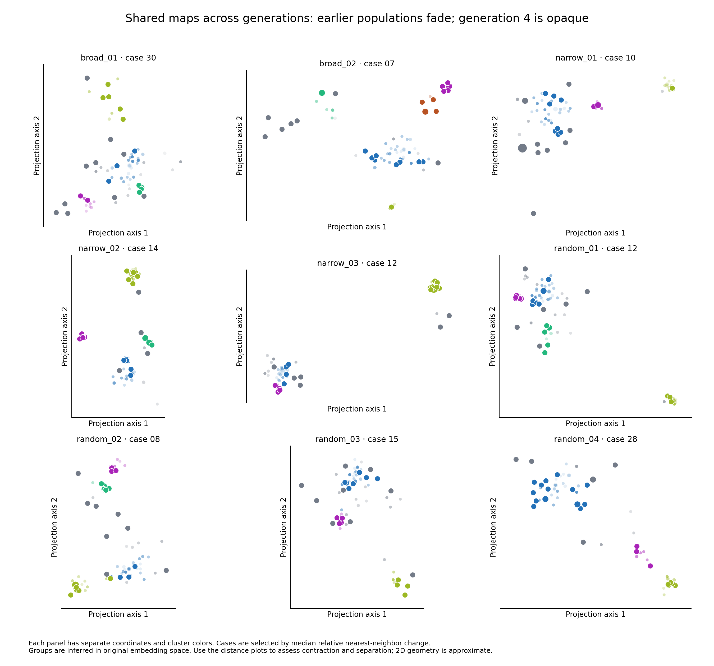
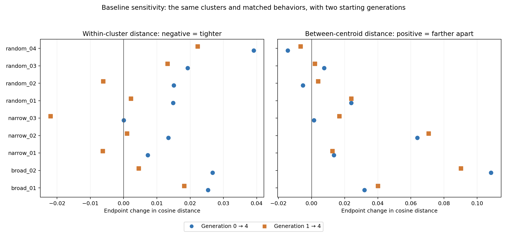
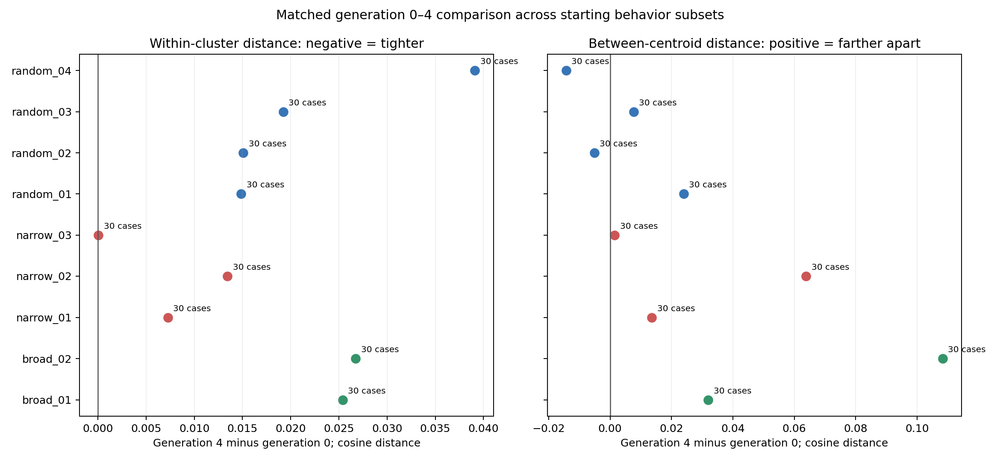

# Clustering figures

Figures from the October 19 comparison across starting behavior subsets.

## Faded generations

Earlier generations are faded and generation 4 is opaque. Each panel has its own coordinates and cluster colors.

## Baseline comparison

## Measured changes

## Additional figures

- [Generation trajectories](clustering_trajectories.png)
- [Case-level changes](case_change_landscape.png)
- [Starting subset overlap](subset_overlap.png)

## Individual runs

| Run | Faded-generation overlay | Generations side by side |
| --- | --- | --- |
| broad_01 | [View overlay](plots/broad_01_repeat_01/semantic_projection.png) | [View generations](plots/broad_01_repeat_01/semantic_generations.png) |
| broad_02 | [View overlay](plots/broad_02_repeat_01/semantic_projection.png) | [View generations](plots/broad_02_repeat_01/semantic_generations.png) |
| narrow_01 | [View overlay](plots/narrow_01_repeat_01/semantic_projection.png) | [View generations](plots/narrow_01_repeat_01/semantic_generations.png) |
| narrow_02 | [View overlay](plots/narrow_02_repeat_01/semantic_projection.png) | [View generations](plots/narrow_02_repeat_01/semantic_generations.png) |
| narrow_03 | [View overlay](plots/narrow_03_repeat_01/semantic_projection.png) | [View generations](plots/narrow_03_repeat_01/semantic_generations.png) |
| random_01 | [View overlay](plots/random_01_repeat_01/semantic_projection.png) | [View generations](plots/random_01_repeat_01/semantic_generations.png) |
| random_02 | [View overlay](plots/random_02_repeat_01/semantic_projection.png) | [View generations](plots/random_02_repeat_01/semantic_generations.png) |
| random_03 | [View overlay](plots/random_03_repeat_01/semantic_projection.png) | [View generations](plots/random_03_repeat_01/semantic_generations.png) |
| random_04 | [View overlay](plots/random_04_repeat_01/semantic_projection.png) | [View generations](plots/random_04_repeat_01/semantic_generations.png) |
